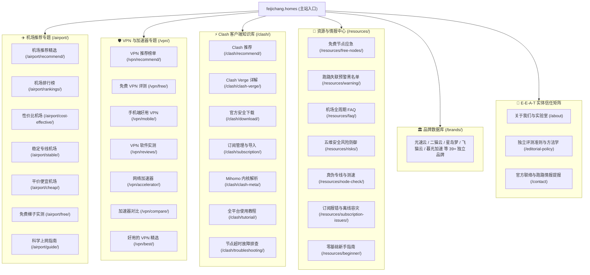

<div align="center">

# ✈️ 飞机场 (feijichang.homes)

**新一代中文机场推荐、跨国网络性能独立实测知识库与品牌数据库平台**

[](https://vitepress.dev/)
[](https://vuejs.org/)
[](https://www.typescriptlang.org/)
[](https://pagefind.app/)
[-10b981?style=for-the-badge)](./Preventive_SEO_Audit_Report.md)
[](./LICENSE)

<p align="center">
  <a href="#-核心特性">核心特性</a> •
  <a href="#-全站架构与知识枢纽">全站架构</a> •
  <a href="#-快速上手">快速上手</a> •
  <a href="#-工程目录规范">目录规范</a> •
  <a href="#-技术-seo-与-geo-规范">SEO 与 GEO 规范</a> •
  <a href="#-免责声明">免责声明</a>
</p>

</div>

---

## 📖 项目愿景与概述

**飞机场（feijichang.homes）** 是专为跨境科研工作者、外贸从业者、出海开发者与普通大众打造的**独立第三方网络链路实测与知识库媒体平台**。

项目依托现代前端工程化方案（VitePress SSG + Vue 3 + Pagefind），彻底摒弃传统内容农场的低质采集与粗制滥造，全面推行**专著级深度创作（单核心专题 10,000—14,000 字）**、**自建多运营商真实晚高峰网络评测实验室（电信/联通/移动）**与**严谨的 GEO/AEO 生成式搜索友好架构**。

---

## ✨ 核心特性

- ⚡ **100% 静态预渲染 (SSG)**：全站 134+ 页面在编译期完成纯静态 HTML 直出，零服务端瓶颈，首屏毫秒级秒开，对各类网络爬虫友好。
- 🔍 **Pagefind 离线毫秒级全站检索**：无需外接 ElasticSearch 或 Algolia 后端，基于 WebAssembly 与高效索引分片，实现全站 62,000+ 词的毫秒级即时中英双语检索。
- 🛡️ **专著级深度与 E-E-A-T 独立评测**：
  - 核心专题均达到专著级深度，详细解析 IEPL/IPLC 物理光纤拓扑、BGP 智能中转与 Hysteria 2 / VLESS 协议演进；
  - 独立上线 [`/about`](./docs/about.md)（评测实验室硬件）、[`/editorial-policy`](./docs/editorial-policy.md)（五大测试标准与晚高峰采样窗口）及 [`/contact`](./docs/contact.md)（跑路风险情报提报）。
- 🤖 **GEO / AEO 生成式引擎深度适配**：
  - **Answer-First 极速决策表**：首屏直击核心痛点，提供 30 秒预算、操作系统与使用场景匹配；
  - **10 列全维度技术对比矩阵**：集成 `white-space: nowrap !important;` 样式，保证移动端与桌面端顺畅水平滑动，杜绝文本折行挤压；
  - **Schema.org 原生级绑定**：动态自动化注入 `WebSite` 与 `BreadcrumbList` 结构化数据，消除语法解析报错。
- 🔒 **严密的外链风控与零隐私泄露**：
  - 590+ 条商业外链 100% 注入 `rel="nofollow sponsored noopener"`，阻断 PageRank 泄露与作弊牵连；
  - 全站零第三方跨站追踪探针（无 GA/Baidu 统计指纹），零物理服务器路径泄露。
- 📱 **全平台响应式与零水平溢出**：
  - 严格通过移动端（375x812）与桌面端（1440x900）双重视口真机校验，确保 `document.documentElement.scrollWidth <= window.innerWidth`，全局零横向晃动。

---

## 🗺️ 全站架构与知识枢纽



---

## 🛠️ 技术栈与依赖

| 依赖技术 | 版本 | 用途与定位 |
| :--- | :--- | :--- |
| **VitePress** | `^1.6.4` | 基于 Vite + Rollup 的超轻量 SSG 静态站点渲染引擎 |
| **Vue 3** | `^3.4.0` | 响应式组件化架构（BrandCard、NetworkPerformanceReport） |
| **Pagefind** | `^1.6.0` | 专为静态站打造的零配置、高性能客户端全文搜索引擎 |
| **TypeScript** | `^5.4.0` | 严格模式类型约束与 VitePress Head 转换插件 |
| **KaTeX** | 内置 | 专业排版数学公式与网络丢包统计模型渲染 |

---

## 🚀 快速上手

### 环境准备

- [Node.js](https://nodejs.org/) `>= 18.0.0` (推荐 LTS 版本)
- [npm](https://www.npmjs.com/) `>= 9.0.0` 或 [pnpm](https://pnpm.io/)

### 1. 克隆代码仓库

```bash
git clone https://github.com/zlzlzl98698-dev/feijichang.homes.git
cd feijichang.homes
```

### 2. 安装项目依赖

```bash
npm install
```

### 3. 启动本地开发热重载服务器

```bash
npm run docs:dev
```
启动后访问本地预览地址：`http://localhost:5173/`。

### 4. 生产环境构建与离线搜索索引生成

```bash
npm run docs:build
```
该命令会自动完成：
1. VitePress SSG 静态 HTML 批量脱水预渲染；
2. 自动注入动态 Canonical 与 JSON-LD 结构化数据；
3. 调用 Pagefind 对 `docs/.vitepress/dist` 产物进行深度分词与倒排索引构建。

### 5. 生产构建产物本地预览

```bash
npm run docs:preview
# 或使用内置预览服务
node scripts/serve.js
```

---

## 📁 工程目录规范

```text
feijichang.homes/
├── docs/                           # 核心内容根目录
│   ├── .vitepress/                 # VitePress 配置与主题扩展
│   │   ├── config.ts               # 站点主配置 (Canonical/Sitemap/Head/Nav)
│   │   ├── theme/                  # 自定义主题与样式
│   │   │   ├── components/         # 交互组件 (BrandCard, Breadcrumb, Report)
│   │   │   ├── custom.css          # 全局样式 (对比表格/nowrap/响应式补丁)
│   │   │   └── index.ts            # 主题入口与组件全量挂载
│   │   └── dist/                   # 生产打包静态直出产物 (被 git 忽略)
│   ├── public/                     # 静态公共资源 (Favicon, Logo, 测试截图)
│   ├── airport/                    # 机场推荐大专题 (7 大细分专著)
│   ├── vpn/                        # VPN 与加速器大专题 (7 大细分专著)
│   ├── clash/                      # Clash 客户端大专题 (7 大细分专著)
│   ├── resources/                  # 资源与情报大专题 (7 大细分专著)
│   ├── brands/                     # 品牌数据库与 39+ 独立品牌实测评测
│   ├── about.md                    # E-E-A-T 实体：关于我们与实验室硬件拓扑
│   ├── editorial-policy.md         # E-E-A-T 实体：独立评测标准与测试方法学
│   ├── contact.md                  # E-E-A-T 实体：官方联络与风险情报提报
│   ├── 404.md                      # 404 自定义错误页面 (配置 noindex)
│   └── index.md                    # 门户全景首页 (万字专著 + 架构导览)
├── scripts/                        # 工程与自动化运维脚本
│   └── serve.js                    # 静态部署环境轻量 HTTP 托管服务
├── Preventive_SEO_Audit_Report.md  # 预防性 SEO 与 GEO 全站深度审计报告 (94分)
├── package.json                    # 项目元数据与脚本指令
├── .gitignore                      # Git 忽略配置
└── README.md                       # 项目自述文件 (当前文档)
```

---

## 🛡️ 技术 SEO 与 GEO 规范

本项目严格遵从工业级技术 SEO 与生成式搜索引擎（GEO/AEO）规范开发：

1. **绝对地址 Canonical 标签自动闭环**：通过 `docs/.vitepress/config.ts` 中的 `transformHead` 钩子，为每个输出页面动态计算并嵌入带有正式域名的 `<link rel="canonical" href="https://feijichang.homes/...">`，彻底规避 cleanUrls、尾部斜杠与追踪参数导致的重复内容降权。
2. **结构化数据 (Schema.org) 100% 语法合规**：
   - 首页搭载 `WebSite` 实体 Schema；
   - 所有子专题与文章搭载由 SSR 阶段编译生成的 `BreadcrumbList` 面包屑 Schema，消除客户端动态脚本导致的语法断裂。
3. **Sitemap 洁净化保障**：XML Sitemap 自动化过滤 `draft` 草稿以及 `404` 错误路由，杜绝 Crawl Budget 爬虫抓取预算浪费。
4. **内部链接规范统一**：全站 100% 采用 `cleanUrls` 格式链接，彻底消除硬编码 `.html` 后缀造成的内部 301 重定向链损耗。
5. **商业链接外链防连坐隔离**：所有指向第三方商业服务商的注册跳转链接，统一由 `<CommercialDisclosure />` 与 `<BrandCard />` 渲染，严格赋予 `rel="nofollow sponsored noopener"` 与 `target="_blank"`。

---

## 🤝 贡献与社区共建

我们非常欢迎社区同行共同维护这个透明、客观的网络知识库！

- 🐛 **提交 Bug 或修正笔误**：欢迎提交 [GitHub Issues](https://github.com/zlzlzl98698-dev/feijichang.homes/issues)；
- 📝 **提供测速数据或情报**：欢迎提报最新的机场跑路线索、协议识别特征或专线割接情报；
- 💡 **发起 Pull Request**：修改或扩充文档前，请先运行 `npm run docs:build` 确保通过静态构建与 Pagefind 索引校验。

---

## ⚖️ 免责声明与开源协议

1. **技术交流与学术初衷**：本平台所刊载之全部网络拓扑解析、协议原理、客户端配置教程及测速数据，仅供跨国学术科研交流、合法跨境办公及网络安全防御实操参考。
2. **法律合规义务**：任何个人或组织在阅读与使用本站内容时，必须严格遵守所在国家与地区的法律法规，严禁利用代理网络从事任何破坏网络安全秩序或侵犯他人合法权益的违法违规行为。
3. **开源许可**：本项目基于 [MIT License](./LICENSE) 协议开放，文档内容保留飞机场编辑部版权所有。

---

<div align="center">

**飞机场 (feijichang.homes) 编辑部**  
*用严谨的工程视角，记录真实的跨境网络生态*

Copyright © 2024–2026 feijichang.homes. All Rights Reserved.

</div>
